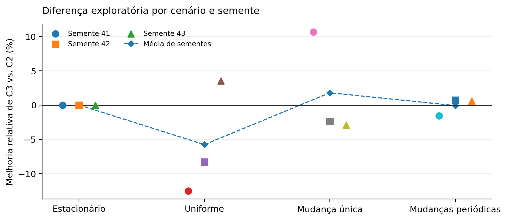

**Natureza do documento:** manuscrito técnico de pesquisa exploratória, não submetido a revisão por pares.  
**Estado final:** linha algorítmica DATE suspensa; hipótese empírica não demonstrada nem refutada em workloads públicos.

# Resumo

**Contexto:** políticas modernas de admissão em cache utilizam estimativas aproximadas de frequência para decidir quais objetos preservar. O horizonte temporal das estimativas é relevante sob mudanças de popularidade, mas mecanismos adaptativos, como o *Evolving Sketch*, já utilizam feedback agregado da aplicação para ajustar o decaimento. **Objetivo:** determinar se a magnitude das diferenças entre os valores estimados de um candidato e de uma vítima fornece informação adicional para selecionar entre horizontes temporais, depois de conhecidos o feedback agregado e as decisões binárias dos estimadores. **Métodos:** formalizou-se a tarefa como uma decisão bayesiana entre dois horizontes sob perda ponderada, derivando uma expressão exata de valor da informação; construiu-se um diagnóstico contrafactual offline com duas instâncias de Count-Min Sketch de decaimento exponencial e oportunidades geradas por LRU; compararam-se seletores fixos, baseados em erro, em feedback e em magnitudes. Foram utilizados quatro workloads sintéticos, três sementes por workload e 30.000 requisições por execução. Uma auditoria subsequente examinou dependência temporal, o mecanismo de admissão W-TinyLFU, o formato *oracleGeneral* e os requisitos de reprodutibilidade. **Resultados:** a identidade decisória foi demonstrada como aplicação de esperança condicional e da desigualdade de Jensen. Nas 12 execuções sintéticas, o controlador com magnitudes (C3) não apresentou vantagem estável sobre o controlador sem magnitudes (C2); a direção das diferenças variou entre sementes. Intervalos exploratórios por blocos incluíram zero em todos os cenários e sementes. Não foram executados benchmarks end-to-end, reprodução de W-TinyLFU/Evolving Sketch nem validações em traces públicos. **Conclusão:** a pergunta é matematicamente bem definida, mas as evidências disponíveis não sustentam eficácia ou novidade algorítmica. DATE foi suspenso como linha principal por custo de oportunidade, permanecendo como hipótese aberta. A contribuição documentada é metodológica e de delimitação, não um novo algoritmo competitivo.

**Palavras-chave:** sistemas de cache; TinyLFU; estimação de frequência; decisão bayesiana; valor da informação; concept drift; avaliação contrafactual; reprodutibilidade.

# Abstract

**Background:** Modern cache admission mechanisms use approximate frequency estimates to decide which objects should remain resident. Under changing access distributions, the estimation horizon matters; however, adaptive approaches such as *Evolving Sketch* already tune decay parameters using application-level feedback. **Objective:** We investigate whether the magnitude of candidate–victim decision margins provides incremental information for selecting temporal estimation horizons, conditional on aggregate feedback and the binary actions recommended by the estimators. **Methods:** We formulate horizon selection as a two-action Bayesian decision problem with weighted loss and derive an exact value-of-information identity. A preliminary offline counterfactual diagnostic combines two exponentially decayed Count-Min Sketches with opportunities produced by a fixed LRU cache. We compare fixed, error-based, feedback-based, and margin-augmented selectors across four synthetic workloads, three random seeds per workload, and 30,000 requests per run. Further audits address time dependence, W-TinyLFU instrumentation, the *oracleGeneral* trace format, and reproducibility. **Results:** The theoretical identity follows from conditional expectations and Jensen's inequality. Across 12 synthetic runs, the margin-augmented selector shows no stable advantage over the feedback-and-action baseline; signs of differences vary across seeds. All exploratory block-bootstrap intervals include zero. No public trace validation, faithful W-TinyLFU/Evolving Sketch benchmark, or end-to-end DATE evaluation was performed. **Conclusion:** The scientific question is well posed, but the available evidence neither establishes practical benefit nor proves the information redundant. DATE is suspended as a principal algorithmic research direction for reasons of research prioritization. The present contribution is a documented framework and a bounded preliminary diagnostic, not a demonstrated new cache algorithm.

**Keywords:** cache admission; frequency sketch; adaptive estimation; decision theory; value of information; distribution drift; offline counterfactual evaluation.

# 1. Introdução

## 1.1. Problema de pesquisa

Caches de capacidade limitada precisam decidir quais objetos manter residentes diante de uma sequência de solicitações. Uma decisão de admissão compara, explícita ou implicitamente, o benefício futuro de reter um candidato com o benefício de preservar outro objeto. Políticas baseadas em frequência aproximada utilizam estruturas compactas de contagem para apoiar a decisão, mas enfrentam um compromisso entre memória histórica e reação a mudanças na distribuição de acessos.

Se o horizonte de observação é muito longo, um objeto que foi popular pode permanecer supervalorizado depois de perder relevância. Se é muito curto, oscilações aleatórias podem provocar decisões instáveis. Ajustar esse horizonte de forma adaptativa é uma ideia natural, porém não é inédita. O *Evolving Sketch*, apresentado no ICDE 2026, adapta parâmetros de decaimento a partir de métricas da aplicação [3]. Assim, a hipótese aqui estudada não pode reivindicar originalidade por simplesmente selecionar janelas ou coeficientes de decaimento online.

A questão da Pesquisa 002 é mais específica: **a intensidade de uma preferência estimada — e não apenas seu sinal — pode ajudar a escolher entre dois horizontes temporais, depois de observadas as demais informações disponíveis?** Denominamos a hipótese de trabalho *Decision-Aware Temporal Estimation* (DATE). Essa denominação identifica um programa de investigação; não designa uma política implementada e validada.

## 1.2. Pergunta, hipótese e objetivos

A pergunta primária é: *em oportunidades de admissão geradas por uma política fixa, as magnitudes normalizadas das margens de decisão fornecem valor incremental para selecionar o horizonte estimador que minimiza a perda contrafactual futura, condicionado ao feedback agregado e ao par de decisões binárias?*

A hipótese operacional **H-DATE-2** afirma que um seletor com acesso a essas magnitudes pode reduzir a perda futura por oportunidade, em comparação com outro seletor que já conhece custos, métricas históricas e as decisões binárias de ambos os horizontes, respeitado um orçamento de metadados equivalente. O critério de engenharia proposto para justificar uma futura política end-to-end exigia benefício superior a 2% em pelo menos dois de três traces públicos independentes de calibração. Esse teste **não foi realizado**.

Os objetivos específicos foram: (i) situar a hipótese em relação aos mecanismos existentes; (ii) formular a condição matemática sob a qual uma variável adicional possui valor decisório; (iii) construir um diagnóstico executável sem antecipação de dados futuros; (iv) medir seu comportamento exploratório; (v) auditar validade estatística, memória e reprodutibilidade; e (vi) decidir se o custo de aprofundar a investigação é justificável.

## 1.3. Delimitação da contribuição

A contribuição consiste em uma **análise aplicada** de teoria da decisão e um estudo diagnóstico preliminar. Não reivindicamos ter descoberto um novo resultado matemático geral, nem demonstrado que DATE aumenta hit rate, reduz custo de misses ou supera W-TinyLFU ou Evolving Sketch. O trabalho também registra decisões de abandono da linha de engenharia, distinguindo rigorosamente falta de evidência de evidência de ausência de efeito.

# 2. Fundamentação e trabalhos relacionados

## 2.1. TinyLFU e W-TinyLFU

TinyLFU combina uma estimativa aproximada de frequência com uma política de admissão: a preferência pelo candidato em relação à vítima depende de valores estimados sob uma memória de observação limitada. O estudo consolidado de Einziger, Friedman e Manes [1] apresenta a estrutura e sua combinação com políticas de substituição. W-TinyLFU acrescenta uma janela de recência para absorver acessos temporários e uma região principal de retenção, tipicamente com política segmentada.

A política de admissão e a política de substituição não são o mesmo mecanismo. Em uma implementação fiel de W-TinyLFU, uma comparação candidato–vítima ocorre, em geral, quando um objeto deixa a janela e compete com o segmento principal — não necessariamente em todo cache miss. Essa diferença tem implicações experimentais diretas sobre a distribuição das oportunidades observadas [1, 9].

## 2.2. Adaptação operacional e Evolving Sketch

O trabalho *Adaptive Software Cache Management* ajusta dinamicamente a repartição entre regiões do cache, incluindo um método de *hill climbing* [2]. Deve-se diferenciar essa variável de controle do **horizonte temporal do estimador de frequência**: alterar a proporção da janela física não equivale a alterar a taxa de decaimento do sketch.

Mais próximo da hipótese DATE, Gao et al. [3] introduziram o *Evolving Sketch*, no qual o decaimento temporal é ajustado a partir de feedback da aplicação. Na implementação pública analisada [10], o benchmark de cache utiliza uma adaptação ε-greedy baseada em uma recompensa proporcional à taxa de acertos observada por intervalo. Um conjunto discreto de parâmetros de decaimento é explorado e atualizado periodicamente. Assim, trocar o sinal agregado por outro sinal não implica, por si só, uma nova classe de estruturas de dados.

## 2.3. Custos heterogêneos e políticas alternativas

Custos de recuperação podem variar entre objetos. Trabalhos como *Boosting Cache Performance by Access Time Measurements* discutem decisões de cache orientadas ao custo de acesso, além da taxa de hits [11]. A presente hipótese usa margens com pesos de custo, mas não afirma que o uso de custos seja inédito.

S3-FIFO [4] e SIEVE [5] ilustram outra direção importante da literatura recente: políticas simples podem ter desempenho e escalabilidade competitivos. Essas referências impõem uma exigência prática à pesquisa de DATE: mesmo que um sinal adicional seja informativo, seu benefício deve compensar overhead de CPU, memória e complexidade operacional.

## 2.4. Valor da informação e inferência temporal

A comparação de informações disponíveis a um decisor remete à teoria de experimentos de Blackwell [6]. Para dados dependentes no tempo, métodos de bootstrap por blocos foram desenvolvidos para preservar parte da estrutura de dependência nas reamostragens [7]. Para uma alegação de benefício em pelo menos dois de três traces, a teoria de hipóteses de conjunção parcial fornece uma forma de lidar com múltiplas condições de validação [8]. Estes são resultados estatísticos existentes, aqui aplicados ao diagnóstico de cache.

# 3. Modelo formal e hipótese identificável

## 3.1. Solicitações, estados e decisões

Seja $x_1,x_2,\dots,x_T$ uma sequência de solicitações em um catálogo de objetos $\mathcal O$. Cada objeto $o$ possui um custo conhecido $c(o)>0$ de miss, constante no diagnóstico sintético. Em uma oportunidade de admissão $t$, uma política fixa produz um candidato $a_t$ e uma vítima $v_t$. Dois estimadores causais, indexados por $h\in\{s,l\}$, produzem estimativas de popularidade $\hat p_h(o\mid\mathcal F_{t-1})$, em que $\mathcal F_{t-1}$ contém apenas solicitações anteriores.

A margem ponderada do horizonte $h$ é

$$
m_h(t)=c(a_t)\,\hat p_h(a_t)-c(v_t)\,\hat p_h(v_t).
$$

A ação recomendada é $A_h(t)=\mathbf 1\{m_h(t)>0\}$, com empate tratado por regra fixa de não admissão. A normalização importa: frequências de janelas de durações distintas não podem ser comparadas diretamente se representarem unidades incompatíveis.

## 3.2. Alvo contrafactual retrospectivo

Após registrar causalmente a oportunidade e as duas decisões, define-se, **somente offline**, uma janela futura de avaliação de $H$ solicitações. Seja $N_{t,H}(o)$ o número de referências ao objeto $o$ entre $t+1$ e $t+H$. O diferencial realizado da troca, em uma comparação hipotética de conjuntos residentes estáticos, é

$$
D_{t,H}=c(a_t)N_{t,H}(a_t)-c(v_t)N_{t,H}(v_t).
$$

A perda retrospectiva associada ao horizonte $h$ é

$$
\ell_t(h)=|D_{t,H}|\;\mathbf 1\{A_h(t)\ne\mathbf 1[D_{t,H}>0]\},\quad D_{t,H}\ne0,
$$

com $\ell_t(h)=0$ quando $D_{t,H}=0$. Essa métrica **não** representa a diferença de miss cost entre duas políticas dinâmicas completas: decisões subsequentes poderiam alterar os estados físicos dos caches e gerar trajetórias distintas. Ela mede o arrependimento de uma única escolha estática sobre o par observado.

Quando $A_s(t)=A_l(t)$, as perdas dos horizontes são iguais para essa oportunidade; por isso, a seleção entre eles não pode melhorar diretamente essa métrica. A fração de oportunidades com decisões divergentes é um indicador de suporte informacional do diagnóstico, não uma prova de poder estatístico.

## 3.3. Informações observáveis e valor marginal

Denote por $Z_t$ as variáveis causais compartilhadas pelo controlador de referência, incluindo feedback agregado, indicadores de erro passado, custos e o par $(A_s,A_l)$. Seja $M_t$ o vetor de magnitudes das margens, por exemplo $(m_s,m_l,|m_s-m_l|)$, também computável do histórico.

Para a escolha $h\in\{s,l\}$, defina o risco do seletor bayesiano ideal:

$$
R(Z)=\mathbb E\!\left[\min_{h\in\{s,l\}}\mathbb E[\ell_h\mid Z]\right],
$$

$$
R(Z,M)=\mathbb E\!\left[\min_{h\in\{s,l\}}\mathbb E[\ell_h\mid Z,M]\right].
$$

O objeto formal de interesse é $V_{\mathrm{mag}}=R(Z)-R(Z,M)$. Esse valor compara seletores ideais **sem** custo de obter e processar a variável adicional. O resultado empírico de classificadores finitos não é uma estimativa não enviesada dessa quantidade.

## 3.4. Proposição e demonstração

**Proposição 1 (valor ideal das magnitudes para duas alternativas).** Suponha $\mathbb E|\ell_s|+\mathbb E|\ell_l|<\infty$ e defina

$$
d(Z,M)=\mathbb E[\ell_s-\ell_l\mid Z,M],\qquad
d(Z)=\mathbb E[\ell_s-\ell_l\mid Z].
$$

Então

$$
\boxed{V_{\mathrm{mag}}=\tfrac12\left(\mathbb E|d(Z,M)|-\mathbb E|d(Z)|\right)\ge0.}
$$

**Demonstração.** A identidade $\min(u,v)=(u+v-|u-v|)/2$ implica

$$
R(Z)=\tfrac12\left(\mathbb E[\ell_s]+\mathbb E[\ell_l]-\mathbb E|d(Z)|\right),
$$

com expressão análoga para $R(Z,M)$. Subtraindo, obtém-se a igualdade enunciada. Pela propriedade da esperança condicional, $d(Z)=\mathbb E[d(Z,M)\mid Z]$. Aplicando Jensen à função convexa $u\mapsto|u|$,

$$
|d(Z)|\le\mathbb E[|d(Z,M)|\mid Z].
$$

Tomando expectativas, conclui-se $V_{\mathrm{mag}}\ge0$. $\square$

**Corolário (condição de igualdade).** O valor é zero se e somente se, para quase todo $Z=z$, a variável $d(z,M)$ não assume valores estritamente positivos e estritamente negativos ambos com probabilidade condicional positiva. Empates com diferença zero não geram benefício por si mesmos. A identidade e a condição derivam de propriedades clássicas da esperança condicional; não constituem nova teoria geral.

Essa condição é mais precisa do que exigir $\mathbb E[\ell_s-\ell_l\mid Z,M]=g(Z)$: a igualdade da esperança condicional é **suficiente**, mas **não necessária**, para valor zero. Magnitudes podem alterar o tamanho da vantagem sem inverter qual alternativa é preferível.

## 3.5. Distinção entre dependência e utilidade de decisão

O critério $I(h^*;M\mid Z)>0$, baseado em informação mútua, não é equivalente a $V_{\mathrm{mag}}>0$ quando as perdas apresentam magnitudes distintas. Um sinal pode não alterar a frequência com que um horizonte é o melhor, mas identificar ocasiões nas quais escolher errado é mais oneroso. Reciprocamente, um sinal pode alterar probabilidades sem alterar a ação ótima condicional. A avaliação deve ponderar **consequências**, não apenas classificação correta.

Nem a endogeneidade das margens — produzidas pelos próprios estimadores — constitui, isoladamente, prova de inutilidade. Ela exige controle rigoroso de circularidade temporal, colisões, feedback e interação entre controlador e política. Sob futuros arbitrários, históricos idênticos podem admitir continuações opostas; nenhuma técnica causal pode garantir antecipação correta em ambos os casos sem hipóteses sobre o processo gerador.

# 4. Materiais e métodos

## 4.1. Hierarquia de evidência adotada

Separou-se a investigação em quatro níveis: (i) resultados analíticos demonstrados; (ii) testes de componentes e verificações de código-fonte; (iii) diagnóstico sintético de decisão estática; e (iv) avaliação de uma política real em traces públicos. O estudo alcançou os três primeiros níveis parcialmente, mas **não** realizou o quarto. Relatórios, arquivos de resultados e código dos ciclos 5–9 constituem os registros primários desta descrição.

## 4.2. Delineamento sintético

A implementação DATE-v0.1 gera eventos com um cache LRU de referência de capacidade 100. O LRU determina candidato (objeto do miss) e vítima (objeto menos recentemente usado). Dois sketches Count-Min com decaimento exponencial são atualizados em paralelo, sem alterar as decisões físicas do LRU. Estimativas utilizadas nos eventos são consultadas antes que a solicitação corrente atualize os contadores. Todas as perdas são construídas em uma etapa posterior, quando a sequência completa já está disponível.

**Tabela 1 — Configuração efetivamente executada no piloto sintético.**

| Parâmetro | Valor / definição |
|---|---|
| Cenários sintéticos | Estacionário Zipf, uniforme, mudança única, mudanças periódicas |
| Sementes | 41, 42 e 43 por cenário |
| Solicitações por execução | 30.000 |
| Objetos possíveis | 10.000 |
| Cache gerador de oportunidades | LRU, 100 slots |
| Sketches | Dois DecayedCMS, profundidade 4, largura 128, contadores `float64` |
| Horizontes de decaimento | 64 e 512 solicitações (parâmetros de decaimento) |
| Horizonte de avaliação retrospectiva | 32 solicitações futuras |
| Custos sintéticos de miss | Por objeto, amostrados de lognormal e limitados a [1, 8] |
| Divisão temporal | Treino com $t+H<0{,}60T$; teste com $t\ge0{,}80T$ |
| Métrica | Perda contrafactual média por oportunidade de admissão |
| Repetições | 12 (4 cenários × 3 sementes) |

O cenário estacionário usa uma distribuição Zipf com expoente 1,18; o uniforme sorteia objetos com probabilidades iguais; *shift* altera a região de objetos populares na metade da sequência; *cycling* desloca ciclicamente o conjunto popular a cada 1.200 solicitações. Os custos são fixados por ID de objeto em cada execução. Trata-se de geradores artificiais, não de amostras representativas de tráfego de produção.

## 4.3. Controladores comparados

**C0 — Fixo:** seleciona, a partir do desenvolvimento, o horizonte com menor perda acumulada. **C1 — Erro:** escolhe o horizonte cuja média móvel exponencial de erro prequential passado é menor. **C2 — Base:** usa erro histórico, hit rate, custos e sinais das ações dos dois horizontes, com regressão logística regularizada e perda de treinamento ponderada. **C2-placebo:** acrescenta quatro variáveis pseudoaleatórias sem relação deliberada com o label, para controlar parcialmente efeitos de dimensionalidade. **C3 — Margens:** acrescenta quatro atributos derivados das margens estimadas.

O classificador não recebe o futuro no instante da decisão. O treino usa o rótulo retrospectivo de qual horizonte incorreu na menor perda, com peso $w_t=|\ell_t(s)-\ell_t(l)|$. Eventos com perdas iguais não contribuem para a escolha entre horizontes. A seleção do probe para o erro prequential ocorre antes da observação correspondente.

Os controladores compartilham a mesma sequência de oportunidades e os mesmos estados dos dois sketches. No protótipo, o total **estimado** de estruturas explícitas foi de 10.184 bytes para C2 e 10.280 bytes para C2-placebo e C3, respectivamente. Essa estimativa não inclui todo o overhead do interpretador Python, a tabela de custos, alocadores ou RSS. Assim, existe um controle aproximado de dimensão entre C3 e placebo, **mas não uma equivalência rigorosa de memória de sistema**.

## 4.4. Verificações de implementação

O protótipo inicial registra nove testes automatizados aprovados; a auditoria estatística ampliou a suíte para treze. Em uma etapa adicional, o extrator de registros binários passou em três testes sintéticos; o pacote pré-holdout passou em onze testes Python e um programa C independente verificou os ordinais do logger. Esses totais representam **conjuntos parcialmente sobrepostos de testes**, não 9 + 13 + 3 + 11 testes distintos. Não se verificou equivalência do logger integrado ao W-TinyLFU original.

# 5. Resultados experimentais

## 5.1. Perda média por cenário

**Tabela 2 — Média aritmética entre três sementes, em unidades de perda contrafactual por oportunidade. Menor é melhor.** Valores extraídos dos registros do piloto sintético, com arredondamento a cinco casas.

| Cenário | C0 fixo | C1 erro | C2 base | C2-placebo | C3 margens | Ações divergentes |
|---|---:|---:|---:|---:|---:|---:|
| Estacionário | 0,02234 | 0,02675 | 0,02250 | 0,02250 | 0,02250 | 22,0% |
| Uniforme | 0,00346 | 0,00377 | 0,00388 | 0,00362 | 0,00405 | 26,7% |
| Mudança única | 0,01913 | 0,02470 | 0,02111 | 0,02065 | 0,02042 | 22,5% |
| Mudanças periódicas | 0,07764 | 0,08114 | 0,07549 | 0,07624 | 0,07550 | 21,4% |

No regime estacionário, C3 e C2 apresentaram perdas idênticas nas três sementes. No uniforme, C3 teve perda média superior tanto à de C2 quanto à do placebo. Na mudança única, C3 exibiu média ligeiramente inferior à de C2, mas permaneceu pior que o seletor fixo C0 e foi instável por semente. Nas mudanças periódicas, C2 e C3 foram praticamente equivalentes em média. A taxa de discordância entre os dois horizontes variou, conforme o cenário, de aproximadamente 21% a 27%, mostrando que existiram decisões distintas a selecionar, mas não garantindo valor adicional da magnitude.

## 5.2. Heterogeneidade entre sementes

**Tabela 3 — Ganho relativo de C3 frente a C2 por semente, definido como $100(\bar\ell_{C2}-\bar\ell_{C3})/\bar\ell_{C2}$. Valor positivo favorece C3.**

| Cenário | Semente 41 | Semente 42 | Semente 43 |
|---|---:|---:|---:|
| Estacionário | 0,00% | 0,00% | 0,00% |
| Uniforme | −12,53% | −8,28% | +3,51% |
| Mudança única | +10,63% | −2,39% | −2,90% |
| Mudanças periódicas | −1,57% | +0,72% | +0,60% |

{width=15.1cm}

*Figura 1. Distribuição das diferenças exploratórias por cenário. Não corresponde a uma análise de poder ou a uma validação pública.*

O caso *shift* demonstra a importância de não interpretar médias como evidência suficiente: o ganho agregado foi influenciado pela semente 41, enquanto as sementes 42 e 43 apresentaram regressão. A avaliação não utilizou repetição suficiente nem um desenho de amostragem que sustentasse generalização para uma população de workloads.

## 5.3. Intervalos exploratórios por blocos

Uma auditoria estatística posterior utilizou reamostragem por blocos móveis, indexados pelo tempo de requisição, e calculou diferenças pareadas $\delta=\ell_{C3}-\ell_{C2}$. Para $H=32$, avaliou-se sensibilidade a comprimentos de bloco 128, 256 e 512. Os intervalos apresentados no relatório com blocos de 256 requisições usaram 250 reamostragens e incluíram zero em **todas as doze execuções**.

Como exemplo, na mudança única, semente 41, a diferença observada foi aproximadamente −0,002991 com intervalo exploratório de percentis de 95% [−0,008107; 0,000000]. Nas sementes 42 e 43, as diferenças foram positivas, respectivamente +0,000445 e +0,000480, com intervalos também contendo zero. O procedimento foi uma auditoria exploratória, não um teste confirmatório com blocos pré-registrados ou garantia de validade sob drift persistente.

Consequentemente, as observações não permitem afirmar superioridade nem equivalência estatística entre C2 e C3. Tampouco demonstram que o valor ideal $V_{\mathrm{mag}}$ seja zero, já que os classificadores treinados em dados finitos não são seletores bayesianos ideais.

# 6. Auditoria de engenharia e reprodutibilidade

## 6.1. Instrumentação fiel do W-TinyLFU

O arquivo `libCacheSim/cache/eviction/WTinyLFU.c` foi inspecionado na referência de código identificada durante o estudo [9]. A comparação de admissão entre o objeto que sai da janela e a vítima do cache principal ocorre em `WTinyLFU_evict()`, depois da verificação de espaço disponível no principal. A função `WTinyLFU_insert()` realiza inserção na janela, e `WTinyLFU_to_evict()` inclui uma advertência contra seu uso. O laço de evicção pode processar múltiplos candidatos numa única requisição. Na implementação examinada, há um `TODO` para adicionar *doorkeeper*.

Foi preparada a estrutura de um logger passivo com identificador da requisição, ordinal interno, IDs de candidato e vítima, estimativas originais e decisão aplicada. Um cabeçalho C e um patcher Python foram testados em componentes isolados. **Não** houve compilação do simulador upstream com o patch aplicado, nem comparação de snapshots lógicos completos (filas, CBF, aging, hits/misses, admissões) entre versões instrumentada e não instrumentada. Não se pode declarar a instrumentação validada.

## 6.2. Memória do filtro de frequência de referência

Na implementação C examinada, a inicialização do filtro `minimalIncrementCBF` com 9.900 entradas e parâmetro de erro 0,001 produz, por cálculo reproduzido a partir da fórmula implementada, **142.339 contadores** de 32 bits e **10 hashes**. O vetor principal ocupa **569.356 bytes (aproximadamente 556 KiB)**. Não estão incluídos ponteiros, metadados das listas, tabelas hash, alocadores nem sketches diagnósticos adicionais.

Para uma configuração hipotética de 10.000 slots unitários com 1% de janela, haveria 100 slots na janela e 9.900 no segmento principal. Essa configuração foi proposta, mas **não** recebeu teste end-to-end. Para avaliar um algoritmo real, seria necessário igualar o orçamento total de metadados online de cada variante, incluindo estimadores, modelos, sementes e estados auxiliares. Contar apenas matrizes NumPy não satisfaz essa exigência.

## 6.3. Traces públicos considerados e não processados

**Tabela 4 — Fontes candidatas para uma validação futura. Arquivos identificados na preparação; nenhum subconjunto foi usado no teste de DATE.**

| Família | Seleção candidata | Natureza | Estado no encerramento |
|---|---|---|---|
| Twitter Twemcache (2020) | `cluster52.oracleGeneral.zst` | Chave-valor | Fonte identificada; sem hash ou avaliação |
| Wikimedia CDN (2019) | `wiki_2019t.oracleGeneral.zst` | Cache de conteúdo textual | Fonte identificada; sem hash ou avaliação |
| MetaCDN (2023) | `meta_reag.oracleGeneral.zst` | Cache de objetos | Fonte identificada; sem hash ou avaliação |

O catálogo `cacheMon/cache_dataset` descreve o formato *oracleGeneral* e a licença CC BY 4.0 da coleção, com necessidade de atribuição às origens dos datasets [12]. Os arquivos são binários comprimidos com registros de 24 bytes no layout compacto `uint32 timestamp`, `uint64 obj_id`, `uint32 obj_size`, `int64 next_access_vtime`. O campo `next_access_vtime` contém informação futura, inadequada para estimadores ou controladores online.

O extrator desenvolvido no estudo utiliza leitura em streaming de registros completos, normaliza `obj_size` para 1 no cenário de capacidade unitária, substitui `next_access_vtime` pelo sentinela −2 e produz hash SHA-256 do subconjunto transformado. O extrator passou em três testes **com dados sintéticos locais**; nenhum arquivo real foi extraído e nenhuma identidade de subset foi fixada por hash. O formato binário impede o uso de `head -n` como operador de truncamento por solicitação. Também não se pode afirmar filtragem de operações GET do Twitter apenas a partir de `oracleGeneral`, que não carrega o campo de operação original.

## 6.4. Estado dos artefatos

Os artefatos arquivados incluem o simulador sintético, resultados por semente, reamostragem por blocos, extrator binário, logger C e testes associados, preservados nas pastas `code/`, `data/` e `tests/`. Nenhum desses componentes foi apresentado como evidência de desempenho end-to-end sem ter sido validado nesse contexto.

# 7. Desenho inferencial proposto, não executado

## 7.1. Estimando um benefício mínimo relevante

Seja $\bar\ell_2$ a perda média do controlador sem magnitudes escolhido **antes** do teste e $\bar\ell_3$ a perda de C3, ambas avaliadas no mesmo conjunto de oportunidades. O limiar de engenharia foi $\tau=0{,}02$. Para $\bar\ell_2>0$, benefício superior a 2% equivale a

$$
\mathbb E[\ell_3-(1-\tau)\ell_2]<0.
$$

Definindo $X_t=\ell_3(t)-0{,}98\ell_2(t)$, o teste unilateral é $H_0:\mathbb E[X_t]\ge0$ versus $H_1:\mathbb E[X_t]<0$. Isso é diferente de testar apenas se $\ell_3<\ell_2$. A probabilidade $P_*(\bar X^*\le\bar X_{\mathrm{obs}})$, calculada de uma distribuição bootstrap convencional centrada na observação, **não** constitui um teste válido dessa hipótese: tende a aproximadamente 0,5 em condições usuais de centralização.

Uma aproximação bootstrap recentralizada para a fronteira nula é

$$
\hat p=\Pr_*\left(\bar X^*-\bar X_{\mathrm{obs}}\le\bar X_{\mathrm{obs}}\right).
$$

O procedimento não é uma garantia finito-amostral: necessita de hipóteses de regularidade, processo temporal adequado e avaliação da calibração. No estudo, a implementação foi testada apenas em condições artificiais e não foi aplicada a dados públicos.

## 7.2. Dependência temporal e blocos móveis

Labels com janelas futuras sobrepostas compartilham solicitações. Por exemplo, com $H=32$, oportunidades em $t=31$ e $t=32$ usam 31 referências futuras em comum, apesar de pertencerem a blocos contíguos diferentes de tamanho 32. Logo, blocos **não sobrepostos** de comprimento $H$ não se tornam independentes automaticamente, e a identidade $n_{\mathrm{eff}}=T/H$ é injustificada.

O procedimento exploratório adotou *moving block bootstrap*, com candidatos a blocos sobrepostos na dimensão do tempo de requisição e preservação do número de oportunidades por segmento. A estatística é a razão entre a soma das diferenças amostradas e o número de oportunidades amostradas, evitando média não ponderada de blocos com densidades distintas. A validade sob regimes não estacionários persistentes continua incerta e precisaria de análise específica [7].

## 7.3. Conjunção parcial e critério de 2 de 3

O plano futuro pretendia demonstrar um benefício superior a 2% em pelo menos dois de três traces. Com valores-p individuais válidos $p_1,p_2,p_3$ para testes unilaterais pré-especificados, uma construção conservadora de conjunção parcial para pelo menos duas rejeições é

$$
p_{\mathrm{PC}}=\min\{1,2p_{(2)}\},
$$

onde $p_{(2)}$ é o segundo menor valor-p [8]. A regra requer $p_{\mathrm{PC}}\le0{,}05$, observadas as hipóteses que tornam válidos os testes individuais. O limite de 2% é uma decisão operacional de prosseguimento, não um limiar físico ou teorema universal.

Esse protocolo permaneceu **pré-holdout**: os três subconjuntos não foram extraídos, a instrumentação não foi verificada, o orçamento total de metadados não foi congelado e os controladores não foram comparados em produção simulada. Não existem valores-p confirmatórios, intervalos de confiança públicos ou conclusões acerca de benefício mínimo.

# 8. Discussão

## 8.1. Interpretação da ausência de ganho estável

As execuções sintéticas são compatíveis com a possibilidade de as magnitudes não adicionarem informação decisória útil nos cenários e seletores estudados; também são compatíveis com um efeito que não pôde ser resolvido com os dados e o procedimento utilizados. O registro de um ganho isolado não constitui evidência robusta de funcionamento, e a igualdade pontual em cenários específicos não prova redundância informacional universal.

A afirmação de que os sinais binários $(A_s,A_l)$ praticamente determinam as magnitudes tampouco segue da matemática: sinais preservam apenas a direção de uma comparação. É possível construir distribuições em que as mesmas decisões binárias coexistem com magnitudes diferentes e com riscos condicionais distintos. A questão não é possibilidade lógica, mas **frequência, previsibilidade e valor econômico** dessas situações em workloads relevantes.

## 8.2. Validade interna e externa

O gerador LRU fixa quais pares candidato–vítima são observados. Um resultado nessa distribuição não pode ser transferido automaticamente às oportunidades de W-TinyLFU, que aparecem em outro momento da política. A métrica de comparação estática ignora consequências de estados físicos divergentes; portanto, não representa redução comprovada de misses de um cache real. Os custos heterogêneos usados foram artificiais, enquanto as fontes públicas planejadas inicialmente seriam avaliadas com custos unitários e objetos unitários. Isso restringe a validade externa da análise.

Os modelos C2 e C3 possuíam conjuntos de variáveis diferentes e estimativas de memória distintas; C2-placebo permitiu controle parcial de dimensionalidade, não equivalência rigorosa de capacidade representacional ou overhead. Além disso, três sementes por cenário não permitem conclusões amplas sobre drift, classes de distribuições ou generalização estatística.

## 8.3. Análise de custo de oportunidade

Para tornar DATE uma hipótese de engenharia testável em condições modernas seriam necessárias, no mínimo, a compilação e instrumentação fiel de W-TinyLFU, verificação diferencial do logger, preparação e hashing dos traces, congelamento do orçamento de memória, calibração inferencial temporal, e escolha prévia do baseline. Mesmo um resultado positivo nesse nível demonstraria inicialmente o valor de um **sinal** no diagnóstico, não uma política superior a Evolving Sketch ou W-TinyLFU.

Dado esse custo e a ausência de evidência sintética estável, a pesquisa foi suspensa como linha algorítmica principal. Essa é uma decisão de priorização de recursos; não é um teste formal que rejeita a existência de $V_{\mathrm{mag}}>0$ em toda classe de workloads.

## 8.4. Boas práticas emergentes

A auditoria metodológica ressaltou a necessidade de separar propriedades históricas, capacidade preditiva e consequências de decisão; de especificar métricas com custos heterogêneos; de preservar causalidade na aquisição das features; de distinguir testes exploratórios de holdouts confirmatórios; e de evitar mudar o protocolo depois de observar dados. Também evidenciou erros que podem parecer pequenos — tratamento de frequências complementares como independentes, extração de binário por linhas, identificação incorreta de pontos de instrumentação, cálculo de um valor-p sem hipótese nula — mas que alteram a validade de uma conclusão científica.

# 9. Limitações e ameaças à validade

**Limitação L1 — Ausência de validação pública:** nenhum dos três traces planejados foi executado. **L2 — Ausência de baseline end-to-end:** W-TinyLFU e Evolving Sketch foram auditados em documentação e código, mas não comparados experimentalmente como políticas reais. **L3 — Métrica contrafactual local:** o alvo é perda numa comparação estática isolada; não é miss ratio ou custo de operação de longo prazo. **L4 — Seleção condicionada:** oportunidades provêm de LRU, não da política moderna que motivou o estudo. **L5 — Modelo sintético:** distribuições Zipf, uniforme e deslocamentos controlados não representam necessariamente cargas reais. **L6 — Inferência limitada:** bootstrap exploratório, três sementes e possível não estacionariedade. **L7 — Memória incompleta:** contagem explícita de arrays e coeficientes não equivale a metadados de sistema ou RSS. **L8 — Viés de seleção:** as decisões exploratórias sobre hipóteses e hiperparâmetros antecederam qualquer holdout congelado; apenas um conjunto de validação independente permitiria inferência confirmatória. **L9 — Reprodução externa:** os testes integrados do simulador instrumentado e os hashes de datasets estão pendentes.

Essas limitações são parte constitutiva do resultado: não devem ser removidas em uma apresentação abreviada do estudo.

# 10. Ética e transparência de dados

Não foram processados dados pessoais nem traces privados. As fontes públicas de produção foram consideradas apenas para planejamento; nenhum subconjunto dessas fontes foi utilizado nos experimentos aqui relatados. Este documento é um manuscrito exploratório, sem revisão por pares, e não constitui reivindicação de descoberta original ou de eficácia operacional comprovada.

# 11. Conclusão

Este estudo formulou uma pergunta científica bem delimitada: determinar se a magnitude de margens de decisão entre candidato e vítima possui valor adicional para escolher horizontes de estimação temporal quando o controlador já conhece as decisões binárias e o feedback agregado. A análise mostrou que o valor ideal do sinal pode ser representado por uma diferença de expectativas do módulo das vantagens condicionais e que o sinal só acrescenta valor decisório quando permite distinguir preferências condicionais estritamente opostas.

O diagnóstico sintético foi implementado e executado em doze configurações de workload e semente, mas não mostrou vantagem consistente do seletor baseado em magnitudes. A auditoria de estatística, memória, formato de dados e código W-TinyLFU produziu ferramentas úteis e identificou requisitos de reprodução que não chegaram a ser integralmente satisfeitos. A investigação **não testou** a hipótese em traces públicos nem em políticas de cache end-to-end.

A conclusão científica estrita é que **não há evidência suficiente, nesta pesquisa, para confirmar ou refutar o benefício empírico de DATE**. A decisão gerencial de suspender a linha é justificada pelo custo de completar o protocolo e pela baixa força dos sinais exploratórios, não por um teorema de impossibilidade. Permanece aberta a investigação do valor das magnitudes em workloads com estrutura de acesso e custos diferentes. Nenhum novo algoritmo competitivo foi demonstrado.

# Referências

[1] EINZIGER, Gil; FRIEDMAN, Roy; MANES, Ben. *TinyLFU: A Highly Efficient Cache Admission Policy*. ACM Transactions on Storage, v. 13, n. 4, art. 35, 2017. DOI: https://doi.org/10.1145/3149371.

[2] EINZIGER, Gil; EYTAN, Ori; FRIEDMAN, Roy; MANES, Ben. *Adaptive Software Cache Management*. Proceedings of the 19th International Middleware Conference, p. 94–106, 2018. DOI: https://doi.org/10.1145/3274808.3274816.

[3] GAO, Ge; DU, Yang; HUANG, He; SUN, Yu-E; TANG, Jianzhi. *Evolving Sketch: Time-Decaying Frequency Estimation for Evolving Streams*. IEEE International Conference on Data Engineering (ICDE), p. 211–223, 2026. DOI: https://doi.org/10.1109/ICDE65706.2026.00023.

[4] YANG, Juncheng; ZHANG, Yazhuo; QIU, Ziyue; YUE, Yao; VINAYAK, Rashmi. *FIFO Queues Are All You Need for Cache Eviction*. Proceedings of the 29th ACM Symposium on Operating Systems Principles (SOSP), 2023. Disponível em: https://pdl.cmu.edu/PDL-FTP/Storage/FIFOqueues-SOSP23_abs.shtml.

[5] ZHANG, Yazhuo et al. *SIEVE is Simpler than LRU: An Efficient Turn-Key Eviction Algorithm for Web Caches*. 21st USENIX Symposium on Networked Systems Design and Implementation (NSDI), 2024. Disponível em: https://www.usenix.org/conference/nsdi24/presentation/zhang-yazhuo.

[6] BLACKWELL, David. *Equivalent Comparisons of Experiments*. The Annals of Mathematical Statistics, v. 24, n. 2, p. 265–272, 1953. DOI: https://doi.org/10.1214/aoms/1177729032.

[7] KÜNSCH, Hans R. *The Jackknife and the Bootstrap for General Stationary Observations*. The Annals of Statistics, v. 17, n. 3, p. 1217–1241, 1989. DOI: https://doi.org/10.1214/aos/1176347265.

[8] BENJAMINI, Yoav; HELLER, Ruth. *Screening for Partial Conjunction Hypotheses*. Biometrics, v. 64, n. 4, p. 1215–1222, 2008. DOI: https://doi.org/10.1111/j.1541-0420.2007.00984.x.

[9] CACHEMON. *libCacheSim: WTinyLFU.c e minimalIncrementCBF.c*. Código-fonte disponível em: https://github.com/cacheMon/libCacheSim. Código consultado a partir de arquivo associado à referência `f7c85f8a538e62129e55e90c0ce4c0f605bd78ba`; equivalência de build não verificada. Acesso em: 19 nov. 2026.

[10] GAO et al. *EvolvingSketch: implementação e benchmarks*. Repositório disponível em: https://github.com/Snowflyt/EvolvingSketch. Acesso em: 19 nov. 2026.

[11] EINZIGER, Gil; HIMELBRAND, Omri; WAISBARD, Erez. *Boosting Cache Performance by Access Time Measurements*. ACM Transactions on Storage, v. 19, n. 1, art. 8, 2023. DOI: https://doi.org/10.1145/3572778.

[12] CACHEMON. *Open-source Cache Dataset*. Documentação e catálogo público. Disponível em: https://github.com/cacheMon/cache_dataset. Acesso em: 19 nov. 2026.

# Apêndice A — Rastreabilidade dos resultados

**Arquivos primários utilizados:** `data/results_synthetic.json`, `data/bootstrap_exploratory.json`, `code/diagnostic.py` e `code/exploratory_stats.py`. Relatórios de auditoria adicionais foram mantidos no registro de preparação experimental. A Tabela 2 usa a **média simples das perdas médias por semente**; não combina todos os eventos em uma única amostra tratada como independente.

**Tabela A1 — Diferença absoluta de perda C3−C2 em cada execução (negativa favorece C3).**

| Cenário | Semente 41 | Semente 42 | Semente 43 |
|---|---:|---:|---:|
| Estacionário | +0,000000 | +0,000000 | +0,000000 |
| Uniforme | +0,000386 | +0,000309 | −0,000169 |
| Mudança única | −0,002991 | +0,000445 | +0,000480 |
| Mudanças periódicas | +0,001078 | −0,000561 | −0,000483 |

A escolha de fontes públicas consideradas foi documentada, mas as URLs e listagens não substituem o SHA-256 dos subconjuntos efetivamente processados, que não existem para esta pesquisa. Os testes que foram relatados como executados não equivalem a uma reprodução independente de toda a cadeia experimental no alvo upstream.

# Apêndice B — Protocolo prospectivo arquivado

Se a hipótese for retomada, um protocolo único e pré-congelado deverá: (1) selecionar o commit e executar W-TinyLFU com e sem logger, verificando equivalência de resultados e estados lógicos por requisição; (2) preparar de forma determinística subconjuntos de traces públicos com hashes e sem acesso online a `next_access_vtime`; (3) fixar cache, sketches, custos, horizontes, treino, embargo, teste, comparador e memória em bytes; (4) medir a perda contrafactual e, secundariamente, misses end-to-end de políticas completas, sem confundir as duas métricas; (5) testar benefício mínimo com inferência dependente do tempo e multiplicidade apropriada; e (6) distinguir **sucesso**, **efeito prático insuficiente**, **regressão** e **inconclusão**. Esse protocolo representa trabalho futuro e não deve ser apresentado como executado.
